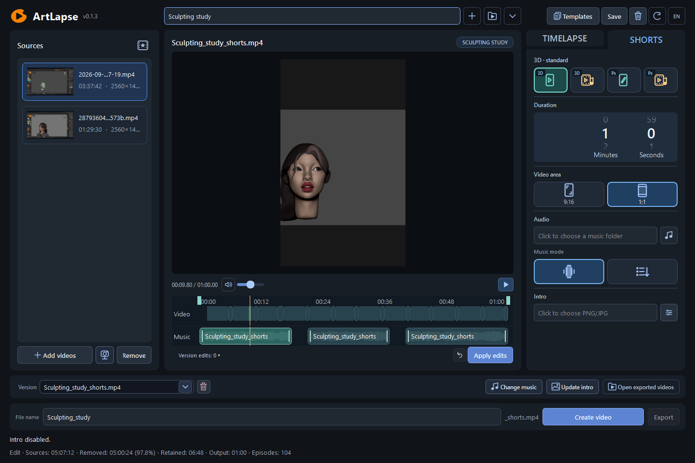
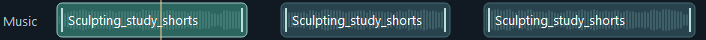
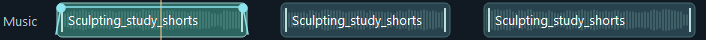

# ArtLapse

**English** | [Русский](README.ru.md)

**[Download ArtLapse 0.1.4 for Windows x64](https://github.com/dmitriyermolenko81/ArtLapse/releases/download/v0.1.4/ArtLapse-0.1.4-Windows-x64.zip)** · [Release notes](https://github.com/dmitriyermolenko81/ArtLapse/releases/tag/v0.1.4)

Extract the entire ZIP and run **ArtLapse.exe**. Python, Qt and FFmpeg are included.


Turn recordings of your creative process into timelapses and Shorts, then refine
the result with video and music editing. ArtLapse runs locally and supports English
and Russian. The primary platform is Windows x64.



Actual application screenshot with a ZBrush sculpting recording. The preview stays
above two compact timelines; editing remains in the main window.

## New in 0.1.4

Hold to select multiple items, batch deletion, compact track and episode labels, both analysis and final episode counts, and export stability fixes. [All changes](docs/releases/0.1.4.md).


- One source episode catalogue for every mode; modes choose different excerpts from it.
- Shared manual source corrections and reusable completed analysis, with cache status.
- Compact video and music timelines inside the main window, with independent edits.
- Real audio waveforms inside music clips, loaded in the background and cached.
- Split, trim and delete music sections without overwriting the following clips.
- Optional fade-in and fade-out curves added from the clip's right-click menu.
- Hover shortcuts: Q to split, Delete to remove, Ctrl+Z / Ctrl+Y to undo / redo.
- Space to play or pause, with protection while typing, dragging or using dialogs.
- Music editing is locked for beat-synced versions to preserve their timing.
- Playback starts at the beginning, including the intro or presentation.
- Refined audio preview synchronization and modern scrollbars, including version lists.

The obsolete still-frame-to-music presets have been removed from the mode selector.
Existing projects retain compatibility.

| Music waveforms | Optional volume fades |
| --- | --- |
|  |  |

## Edit directly on the timeline

Hover over the **video** or **music** lane and press **Q** to split at the mouse
position. No click to activate the lane is needed. Use **Delete**, **Ctrl+Z** and
**Ctrl+Y** on that lane; **Space** controls playback. Drag a clip's edges to trim it.
Apply edits to produce a new version while keeping the previous result.

Right-click a music fragment to add or remove a fade. Fades are off by default.
Add a track in a free gap: it stops before the next fragment and preserves the
music already there. Beat-synced versions show music as read-only.

## From recording to finished video

1. Create or open a project and add MP4, MKV or MOV recordings.
2. Choose a mode, duration, framing, music and an optional intro/presentation.
3. Create the video; completed compatible analysis is reused.
4. Review and adjust episodes, video and music. Original recordings stay unchanged.

| Section | Modes |
| --- | --- |
| TIMELAPSE | Episode selection or continuous speed-up |
| SHORTS | 3D or Photoshop video episodes, with optional beat synchronization |

Shorts support vertical and square layouts. Intro and presentation sections fit
within the total duration. Final exports use original recordings; previews may use proxies.
Projects, versions and settings templates let you resume work later.

## Updates and support

ArtLapse checks GitHub for updates in the background. The circular-arrow button
checks again. Download the new ZIP and extract it into a separate folder. To keep
preferences, close ArtLapse and copy the previous application's **data** folder to
the new one. Keep projects and source media in place. [Update guide](docs/updates.md).

ArtLapse is free to use. Optional [support on Boosty](https://boosty.to/manson93)
is not required to download or use the application.

## Run from source

You need Python **3.10+**, FFmpeg, and ffprobe available in `PATH`. The verified
environment is Windows 10 x64, Python 3.10, and PySide6 6.8.3.
FFmpeg must support `libx264`. Installing Python dependencies requires access to
the package index.

Run these commands in PowerShell:

```powershell
git clone https://github.com/dmitriyermolenko81/ArtLapse.git ArtLapse
cd ArtLapse
python -m venv .venv
.\.venv\Scripts\python.exe -m pip install -e ".[dev]"
.\.venv\Scripts\python.exe -m artlapse doctor
.\.venv\Scripts\python.exe -m artlapse.ui
```

If FFmpeg is not in `PATH`, set its full path and the path to ffprobe:

```powershell
$env:ARTLAPSE_FFMPEG = "C:\Tools\ffmpeg\bin\ffmpeg.exe"
$env:ARTLAPSE_FFPROBE = "C:\Tools\ffmpeg\bin\ffprobe.exe"
```

In the application, create a project with **+**, add your recordings, choose a
mode, duration, and music, then click **Create video**. The **RU / EN** button in
the upper-right corner changes the interface language. Scroll to adjust duration;
click a number with the left mouse button to type a value.

**Templates** in the top toolbar stores named sets of editing settings. Use **+**
to enter a new name in the same row, **✓** to save or apply, and the trash icon to
delete. During creation, **+** becomes **×**; click it or press Escape to return to
the previous selection. Applying a template keeps the current sources and manual
edits, and can be undone with Ctrl+Z.

## Command line

```powershell
.\.venv\Scripts\python.exe -m artlapse --help
.\.venv\Scripts\python.exe -m artlapse run "D:\ArtLapseProjects\demo" "D:\Videos\recording.mp4" --target-seconds 600 --output "D:\Exports\timelapse.mp4"
```

Source recordings, music, and user projects are not included in the repository.
You can generate synthetic recordings for local checks:

```powershell
.\.venv\Scripts\python.exe -m artlapse fixtures artifacts/fixtures
```

## Portable Windows version

If you have a portable ZIP build, extract the **entire folder** and run
`ArtLapse.exe`. Such a build includes Python, FFmpeg, and ffprobe; settings and
logs are stored in `data` beside the executable.
The short Russian/English first-run guide is [Start.txt](packaging/Start.txt).
Move the whole application folder, including its supporting files.
This source repository does not include application executables or user videos.
Build instructions: [docs/windows_build.md](docs/windows_build.md).

## Checks

```powershell
.\.venv\Scripts\python.exe -m pytest -q
.\.venv\Scripts\python.exe -m ruff check .
.\.venv\Scripts\python.exe -m mypy src
```

Integration checks require FFmpeg/ffprobe and an available desktop session.
Optional local feedback-service tests require Node.js with the `node:sqlite`
module; they are skipped when it is unavailable.

For a full local validation with logs, a real short export, ffprobe, complete
decoding, and an application window:

```powershell
.\.venv\Scripts\python.exe scripts/validate.py
```

Results are saved in a new `artifacts/validation-*` folder outside Git.
Only a final `PASS` in `report.json` confirms that the full run passed.

GitHub Actions runs Ruff, mypy, and fast tests without FFmpeg. Full media and GUI
validation is performed locally using the command above; the two checks cover
different scopes. Workflow: [.github/workflows/quality.yml](.github/workflows/quality.yml).

## Project layout

| Directory | Contents |
| --- | --- |
| `src/sculptcut` | Models, analysis, planning, rendering, and the PySide6 interface |
| `tests` | Unit, integration, and GUI checks |
| `packaging` | Windows builds, portable ZIP packaging, and component licenses |
| `scripts` | Reproducible application validation |
| `services/feedback` | An optional feedback service, without personal configuration |
| `docs` | Guides and the annotation format |

Optional feedback-service setup: [docs/feedback_setup.md](docs/feedback_setup.md).
It is not required for editing or exporting videos.

Changes: [CHANGELOG.md](CHANGELOG.md). Contribution workflow:
[CONTRIBUTING.md](CONTRIBUTING.md).
Local validation results: [GitHub source preparation](docs/GITHUB_PREPARATION.md).
Some linked project documents are currently in Russian.

## Limitations

Analysis uses pixels; it does not know the model's geometry or undo history.
A similar frame does not prove that work was undone, so review the result.
Recognition quality has not been established on a labeled dataset of real
recordings. Long videos require disk space for proxies and caches.
Behavior on macOS and Linux has not been separately verified.

## Licenses

Terms for free personal and commercial use: [LICENSE](LICENSE).
The application is not offered under an open-source license; third-party
licenses are retained. Replacing LGPL libraries: [guide](docs/LIBRARY_REPLACEMENT.md).
Windows release validation: [status](docs/launch/RELEASE_CHECKLIST.md).
Optional [library sources](https://github.com/dmitriyermolenko81/ArtLapse/releases/download/v0.1.0/ArtLapse-0.1.0-ThirdParty-Sources.zip)
are unchanged from 0.1.0 and are not needed to run the application.
Dependency licenses and component notices are in
[packaging/THIRD_PARTY_NOTICES.md](packaging/THIRD_PARTY_NOTICES.md)
and [packaging/licenses](packaging/licenses).

The application was previously called SculptCut. Existing projects and settings
remain compatible. The `sculptcut` Python API and legacy commands are retained;
the new commands are `artlapse` / `artlapse-gui`, or `python -m artlapse` /
`python -m artlapse.ui`.
