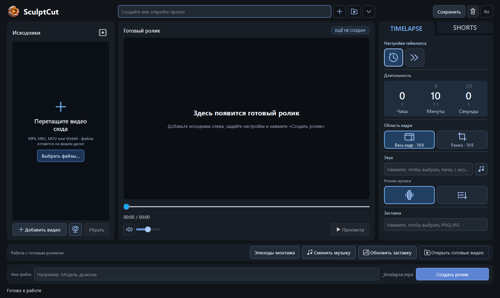

# SculptCut


Локальный редактор длинных записей скульптинга ZBrush: из готовых MP4, MKV
и MOV он собирает таймлапсы и короткие ролики, оставляя возможность ручных правок.
Интерфейс — на русском и английском. Основная платформа — Windows x64.

## Возможности

- Анализ активности, сокращение пауз и монтаж под заданную длительность.
- Таймлапс, простое ускорение, Shorts и монтаж под музыкальные акценты.
- Выбор области кадра, вертикальная и квадратная компоновка.
- Своя музыка, заставка и отдельный презентационный клип проекта.
- Просмотр эпизодов, ручные исключения, подрезка, отмена и повтор действий.
- Проекты, сохранённые варианты и повторное использование кэша анализа.
- Локальная обработка; итоговый экспорт использует оригиналы, не изменяя их.

Это редактор существующих записей. Рекордер и плагин ZBrush не требуются.



## Запуск из исходников

Нужны Python **3.10+**, FFmpeg и ffprobe в `PATH`. Проверенная среда:
Windows 10 x64, Python 3.10, PySide6 6.8.3. FFmpeg должен поддерживать `libx264`.
Установка Python-зависимостей требует доступа к пакетному индексу.

Из корня репозитория в PowerShell:

```powershell
git clone https://github.com/dmitriyermolenko81/SculptCut.git
cd SculptCut
python -m venv .venv
.\.venv\Scripts\python.exe -m pip install -e ".[dev]"
.\.venv\Scripts\python.exe -m sculptcut doctor
.\.venv\Scripts\sculptcut-gui.exe
```

Если FFmpeg отсутствует в `PATH`, задайте полные пути:

```powershell
$env:SCULPTCUT_FFMPEG = "C:\Tools\ffmpeg\bin\ffmpeg.exe"
$env:SCULPTCUT_FFPROBE = "C:\Tools\ffmpeg\bin\ffprobe.exe"
```

В окне создайте проект кнопкой **+**, добавьте видео, выберите режим,
длительность и музыку, затем нажмите **«Создать ролик»**. Кнопка **RU / EN**
справа вверху переключает язык. Колесо меняет длительность без текстового
курсора; ручной ввод включается щелчком ЛКМ по числу.

## Командная строка

```powershell
.\.venv\Scripts\python.exe -m sculptcut --help
.\.venv\Scripts\python.exe -m sculptcut run "D:\SculptCutProjects\demo" "D:\Videos\recording.mp4" --target-seconds 600 --output "D:\Exports\timelapse.mp4"
```

Исходные записи, музыка и пользовательские проекты в репозиторий не входят.
Для локальной проверки можно сгенерировать синтетические записи:

```powershell
.\.venv\Scripts\python.exe -m sculptcut fixtures artifacts/fixtures
```

## Переносная версия Windows

Если используете готовый переносной ZIP, распакуйте **всю папку** и запустите
`SculptCut.exe`. В такой сборке Python, FFmpeg и ffprobe находятся внутри;
настройки и журналы сохраняются в `data` рядом с EXE.
Исходный репозиторий не содержит готовых EXE или видео.
Инструкции сборки: [docs/windows_build.md](docs/windows_build.md).

## Проверки

```powershell
.\.venv\Scripts\python.exe -m pytest -q
.\.venv\Scripts\python.exe -m ruff check .
.\.venv\Scripts\python.exe -m mypy src
```

Интеграционным проверкам нужны FFmpeg/ffprobe и доступный рабочий стол.
Необязательным тестам локального сервиса обратной связи нужен Node.js
с модулем `node:sqlite`; при его отсутствии они пропускаются.

Полная локальная проверка с журналами, реальным коротким экспортом,
ffprobe, декодированием и запуском окна:

```powershell
.\.venv\Scripts\python.exe scripts/validate.py
```

Результаты сохраняются в новой папке `artifacts/validation-*`, вне Git.
Только итоговый `PASS` в `report.json` подтверждает полный прогон.

## Устройство проекта

| Каталог | Содержимое |
| --- | --- |
| `src/sculptcut` | Модели, анализ, планировщик, рендер и PySide6-интерфейс |
| `tests` | Модульные, интеграционные и GUI-проверки |
| `packaging` | Сборка Windows, переносной ZIP и лицензии компонентов |
| `scripts` | Воспроизводимая проверка приложения |
| `services/feedback` | Необязательный сервис обратной связи, без личных конфигов |
| `docs` | Инструкции и формат разметки |

Настройка необязательного сервиса: [docs/feedback_setup.md](docs/feedback_setup.md).
Он не нужен для монтажа и экспорта.

## Ограничения

Анализ опирается на пиксели: он не знает геометрию модели и историю Undo.
Похожий кадр не доказывает отмену работы; результат нужно просматривать.
Качество распознавания не заявляется подтверждённым на размеченном наборе
реальных записей. Длинные видео требуют места для proxy и кэша.
Поведение на macOS и Linux отдельно не подтверждено.

## Лицензии

Отдельная лицензия исходного кода SculptCut пока не выбрана.
Лицензии зависимостей и уведомления о компонентах находятся в
[packaging/THIRD_PARTY_NOTICES.md](packaging/THIRD_PARTY_NOTICES.md)
и [packaging/licenses](packaging/licenses).
