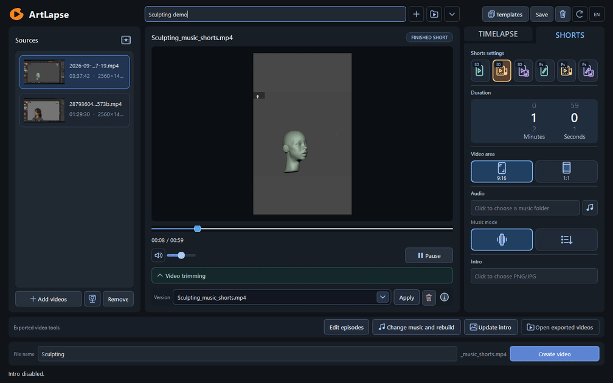
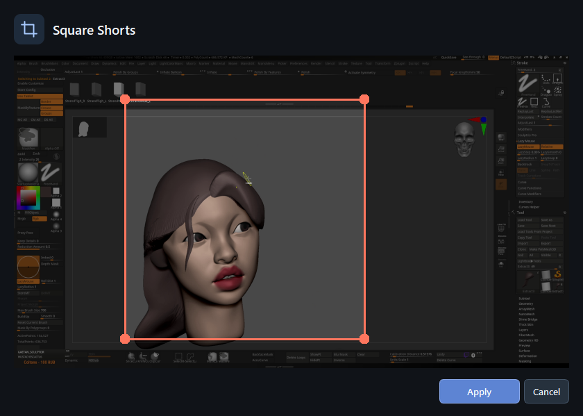
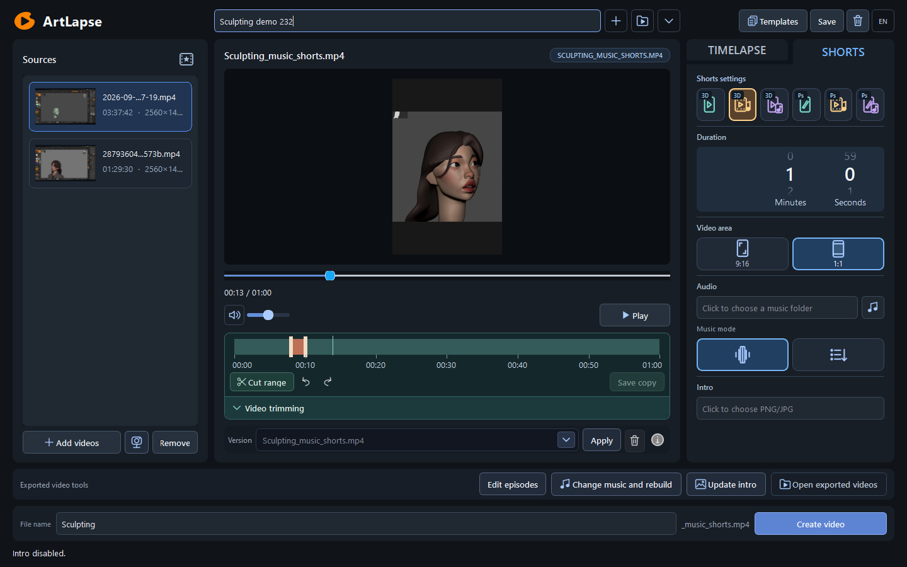
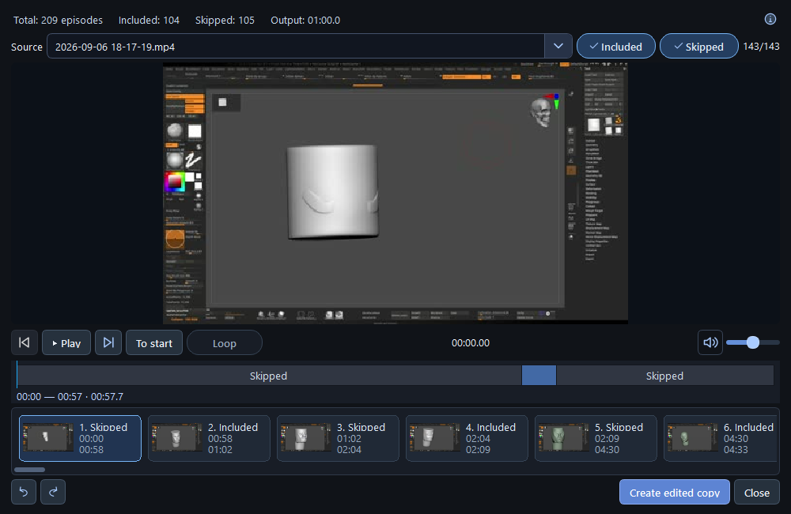
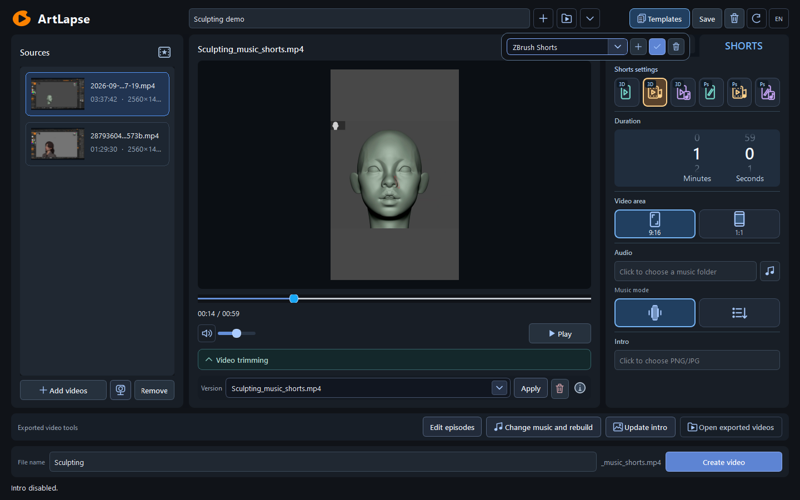

# ArtLapse

**English** | [Русский](README.ru.md)

[Download source preview](https://github.com/dmitriyermolenko81/SculptCut/releases/tag/v0.1.0-preview.231). Python and FFmpeg are required; the Windows binary archive is pending the remaining dependency checks.


A local editing tool for artists: turn recordings of your creative process into
timelapses and Shorts, then refine the result with manual edits.
The interface supports English and Russian. The primary platform is Windows x64.



Actual application footage: source recordings on the left, the finished video in
the center, and editing settings on the right. This example shows ZBrush sculpting
and a one-minute music-synced Short.
[Open the full-resolution screenshot](docs/images/en/workspace.png).

## From recording to finished video

| Choose your framing | Trim the result |
| --- | --- |
| [](docs/images/en/framing.png) | [](docs/images/en/trimming.png) |
| Move and resize the frame. This screenshot shows the square framing dialog for Shorts. | Select an unwanted section on the timeline. After cutting it, you can save a separate copy of the video. |

| Review episodes | Reuse your settings |
| --- | --- |
| [](docs/images/en/episodes.png) | [](docs/images/en/templates.png) |
| Review the source preview and compact episode cards. The selected episode is remembered when you reopen the window. | Save and apply settings using the list, plus, checkmark, and trash icons. During creation, the plus becomes a cancel button. |

Click an image to view the interface at full resolution.
These are screenshots of the running application with a real project.

ArtLapse is free to use. If it saves you time, you can
[support development on Boosty](https://boosty.to/manson93).
Support is optional and is not required to download or use the application.

## Features

- Activity analysis, idle-time reduction, and editing to a target duration.
- Timelapses, straightforward speed-up, Shorts, and cuts timed to musical accents.
- Video framing, with vertical and square layouts.
- Your own music, an intro image, and a separate project presentation clip.
- Episode review, manual exclusions, trimming, undo, and redo.
- Saved projects, video variants, reusable analysis caches, and settings templates.
- Local processing; final exports use the original recordings without changing them.

ArtLapse edits existing recordings. No recorder or ZBrush plugin is required.

## Editing modes

| Section | Mode | Result |
| --- | --- | --- |
| TIMELAPSE | Episodes | Key stages of the creative process, with detected pauses reduced |
| TIMELAPSE | Speed-up | An accelerated recording without automatic cuts |
| SHORTS | 9:16 | A short vertical edit of sculpting episodes |
| SHORTS | Music-synced episodes | Moving video excerpts with cuts timed to musical accents |
| SHORTS | Music-synced still frames | Still images that change to the rhythm of the music |
| SHORTS | Photoshop 9:16 | A drawing-process edit framed within the canvas |
| SHORTS | Photoshop: music-synced episodes | Moving excerpts of the drawing process, timed to musical accents |
| SHORTS | Photoshop: music-synced still frames | Still images of drawing stages, timed to the music |

Shorts support vertical and square layouts. The intro and presentation clip fit
within the selected total duration. When a presentation clip is selected, the
intro image is omitted. In square music-synced video episodes, the camera stays
fixed within each episode; rotations and zooms recorded in the source remain visible.

## Run from source

You need Python **3.10+**, FFmpeg, and ffprobe available in `PATH`. The verified
environment is Windows 10 x64, Python 3.10, and PySide6 6.8.3.
FFmpeg must support `libx264`. Installing Python dependencies requires access to
the package index.

Run these commands in PowerShell:

```powershell
git clone https://github.com/dmitriyermolenko81/SculptCut.git ArtLapse
cd ArtLapse
python -m venv .venv
.\.venv\Scripts\python.exe -m pip install -e ".[dev]"
.\.venv\Scripts\python.exe -m artlapse doctor
.\.venv\Scripts\python.exe -m artlapse.ui
```

If FFmpeg is not in `PATH`, set its full path and the path to ffprobe:

```powershell
$env:ARTLAPSE_FFMPEG = "C:\Tools\ffmpeg\bin\ffmpeg.exe"
$env:ARTLAPSE_FFPROBE = "C:\Tools\ffmpeg\bin\ffprobe.exe"
```

In the application, create a project with **+**, add your recordings, choose a
mode, duration, and music, then click **Create video**. The **RU / EN** button in
the upper-right corner changes the interface language. Scroll to adjust duration;
click a number with the left mouse button to type a value.

Trimming opens above its toolbar and reduces the preview height without resizing
the application. **Save copy** offers **Just cut** or **Cut and keep duration**.
Keeping duration works across all eight modes when enough source material is
available; it restores an intro or presentation section removed by the trim and
fills the remaining time with the edited body. The previous version is preserved.

Trims and episode changes are combined. **Create video** also includes pending
trims before you save a separate copy. The trash button beside the version list
deletes the selected generated version, with confirmation.

**Templates** in the top toolbar stores named sets of editing settings. Use **+**
to enter a new name in the same row, **✓** to save or apply, and the trash icon to
delete. During creation, **+** becomes **×**; click it or press Escape to return to
the previous selection. Applying a template keeps the current sources and manual
edits, and can be undone with Ctrl+Z.

## Command line

```powershell
.\.venv\Scripts\python.exe -m artlapse --help
.\.venv\Scripts\python.exe -m artlapse run "D:\ArtLapseProjects\demo" "D:\Videos\recording.mp4" --target-seconds 600 --output "D:\Exports\timelapse.mp4"
```

Source recordings, music, and user projects are not included in the repository.
You can generate synthetic recordings for local checks:

```powershell
.\.venv\Scripts\python.exe -m artlapse fixtures artifacts/fixtures
```

## Portable Windows version

If you have a portable ZIP build, extract the **entire folder** and run
`ArtLapse.exe`. Such a build includes Python, FFmpeg, and ffprobe; settings and
logs are stored in `data` beside the executable.
The short Russian/English first-run guide is [Start.txt](packaging/Start.txt).
Move the whole application folder, including its supporting files.
This source repository does not include application executables or user videos.
Build instructions: [docs/windows_build.md](docs/windows_build.md).

## Checks

```powershell
.\.venv\Scripts\python.exe -m pytest -q
.\.venv\Scripts\python.exe -m ruff check .
.\.venv\Scripts\python.exe -m mypy src
```

Integration checks require FFmpeg/ffprobe and an available desktop session.
Optional local feedback-service tests require Node.js with the `node:sqlite`
module; they are skipped when it is unavailable.

For a full local validation with logs, a real short export, ffprobe, complete
decoding, and an application window:

```powershell
.\.venv\Scripts\python.exe scripts/validate.py
```

Results are saved in a new `artifacts/validation-*` folder outside Git.
Only a final `PASS` in `report.json` confirms that the full run passed.

GitHub Actions runs Ruff, mypy, and fast tests without FFmpeg. Full media and GUI
validation is performed locally using the command above; the two checks cover
different scopes. Workflow: [.github/workflows/quality.yml](.github/workflows/quality.yml).

## Project layout

| Directory | Contents |
| --- | --- |
| `src/sculptcut` | Models, analysis, planning, rendering, and the PySide6 interface |
| `tests` | Unit, integration, and GUI checks |
| `packaging` | Windows builds, portable ZIP packaging, and component licenses |
| `scripts` | Reproducible application validation |
| `services/feedback` | An optional feedback service, without personal configuration |
| `docs` | Guides and the annotation format |

Optional feedback-service setup: [docs/feedback_setup.md](docs/feedback_setup.md).
It is not required for editing or exporting videos.

Changes: [CHANGELOG.md](CHANGELOG.md). Contribution workflow:
[CONTRIBUTING.md](CONTRIBUTING.md).
Local validation results: [GitHub source preparation](docs/GITHUB_PREPARATION.md).
Some linked project documents are currently in Russian.

## Limitations

Analysis uses pixels; it does not know the model's geometry or undo history.
A similar frame does not prove that work was undone, so review the result.
Recognition quality has not been established on a labeled dataset of real
recordings. Long videos require disk space for proxies and caches.
Behavior on macOS and Linux has not been separately verified.

## Licenses

Terms for free personal and commercial use: [LICENSE](LICENSE).
The application is not offered under an open-source license; third-party
licenses are retained. Replacing LGPL libraries: [guide](docs/LIBRARY_REPLACEMENT.md).
Public binary distribution is not ready yet: [status](docs/launch/RELEASE_CHECKLIST.md).
Dependency licenses and component notices are in
[packaging/THIRD_PARTY_NOTICES.md](packaging/THIRD_PARTY_NOTICES.md)
and [packaging/licenses](packaging/licenses).

The application was previously called SculptCut. Existing projects and settings
remain compatible. The `sculptcut` Python API and legacy commands are retained;
the new commands are `artlapse` / `artlapse-gui`, or `python -m artlapse` /
`python -m artlapse.ui`. The existing GitHub and Telegram addresses remain unchanged.
