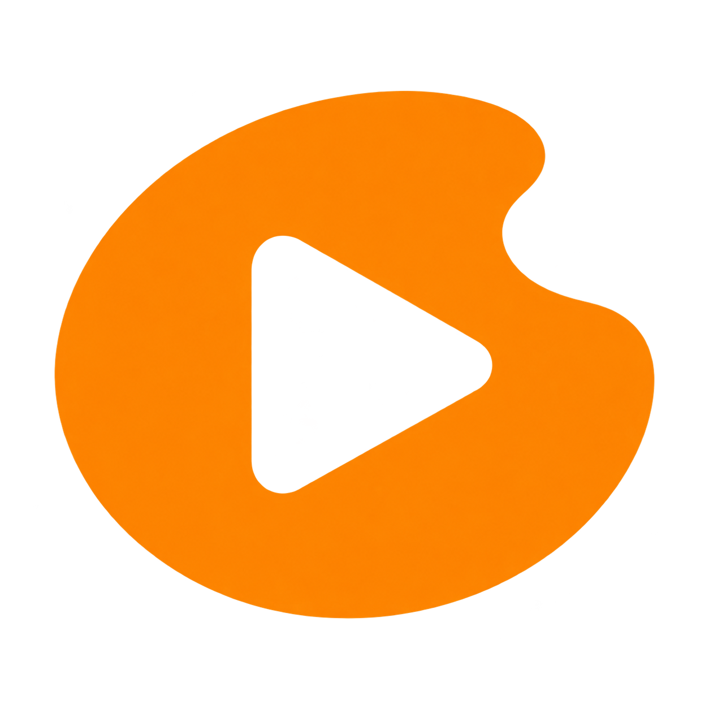
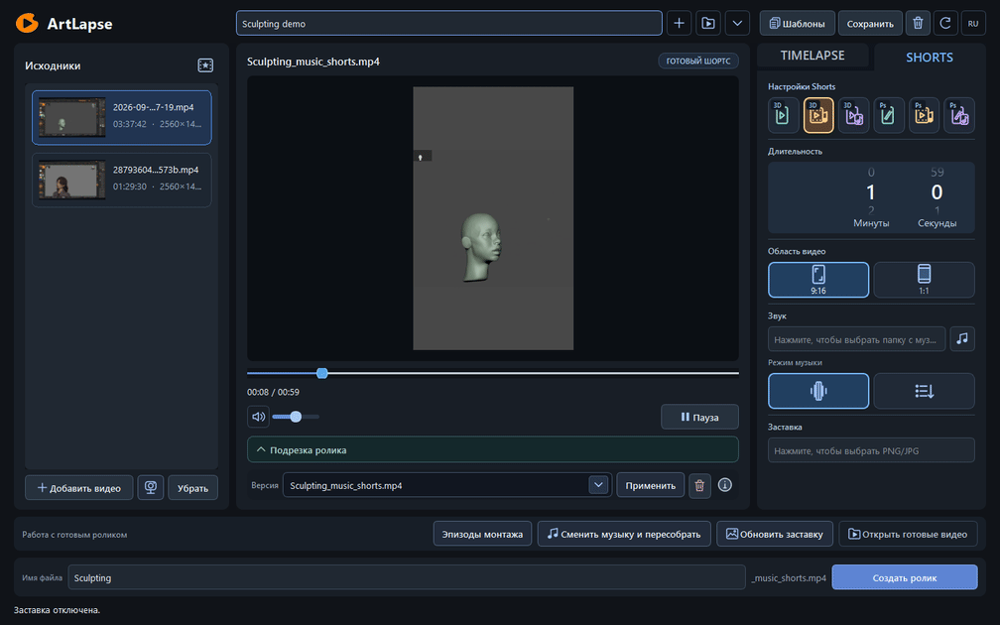
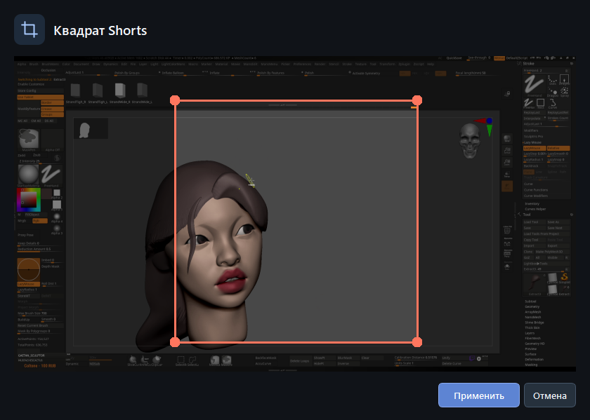
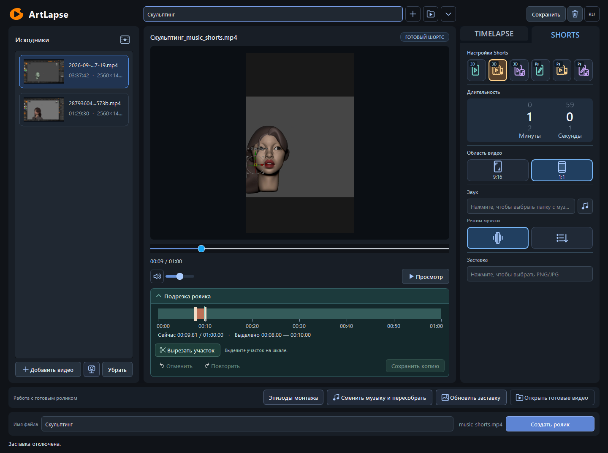

# ArtLapse



Локальный автоматизированный инструмент для художников: из записей творческого
процесса он собирает таймлапсы и шортсы для публикации, с возможностью ручных правок.
Интерфейс — на русском и английском. Основная платформа — Windows x64.



Реальная запись окна: исходники слева, готовый ролик в центре, настройки монтажа
справа. На примере — скульптинг в ZBrush и музыкальный Shorts длительностью одну минуту.
[Открыть чёткий скриншот целиком](docs/images/workspace.png).

## От исходника до готового ролика

| Выберите область кадра | Подрежьте результат |
| --- | --- |
| [](docs/images/framing.png) | [](docs/images/trimming.png) |
| Рамку можно перемещать и менять её размер. На снимке открыт выбор квадрата для Shorts. | Выделите ненужный участок на шкале. После вырезки можно сохранить отдельную копию ролика. |

Нажмите на изображение, чтобы рассмотреть интерфейс в полном размере.
Это снимки запущенного приложения с реальным проектом, без макетов интерфейса.

ArtLapse распространяется бесплатно. Если приложение помогает вам экономить
время, можно [поддержать разработку на Boosty](https://boosty.to/manson93).
Поддержка добровольная и не требуется для скачивания или использования программы.

## Возможности

- Анализ активности, сокращение пауз и монтаж под заданную длительность.
- Таймлапс, простое ускорение, Shorts и монтаж под музыкальные акценты.
- Выбор области кадра, вертикальная и квадратная компоновка.
- Своя музыка, заставка и отдельный презентационный клип проекта.
- Просмотр эпизодов, ручные исключения, подрезка, отмена и повтор действий.
- Проекты, сохранённые варианты и повторное использование кэша анализа.
- Локальная обработка; итоговый экспорт использует оригиналы, не изменяя их.

Это редактор существующих записей. Рекордер и плагин ZBrush не требуются.

## Режимы монтажа

| Раздел | Режим | Результат |
| --- | --- | --- |
| TIMELAPSE | Эпизоды | Основные этапы работы с сокращением найденных пауз |
| TIMELAPSE | Ускорение | Ускоренная запись без автоматических вырезок |
| SHORTS | 9:16 | Короткий вертикальный монтаж эпизодов скульптинга |
| SHORTS | Эпизоды под музыку | Движущиеся видеоэпизоды со склейками по музыкальным акцентам |
| SHORTS | Кадры под музыку | Стоп-кадры, сменяющиеся в ритме музыки |
| SHORTS | Photoshop 9:16 | Монтаж рисования с кадрированием внутри холста |
| SHORTS | Photoshop: эпизоды под музыку | Движущиеся отрывки рисования под музыкальные акценты |
| SHORTS | Photoshop: кадры под музыку | Стоп-кадры отдельных стадий рисунка под музыку |

Для Shorts доступны вертикальная и квадратная компоновки. Заставка и презентация
входят в выбранную длительность. При выбранной презентации картинка-заставка
не участвует. В квадратных музыкальных видеоэпизодах камера неподвижна внутри
эпизода; повороты и зум исходной записи остаются видимыми.

## Запуск из исходников

Нужны Python **3.10+**, FFmpeg и ffprobe в `PATH`. Проверенная среда:
Windows 10 x64, Python 3.10, PySide6 6.8.3. FFmpeg должен поддерживать `libx264`.
Установка Python-зависимостей требует доступа к пакетному индексу.

Из корня репозитория в PowerShell:

```powershell
git clone https://github.com/dmitriyermolenko81/SculptCut.git ArtLapse
cd ArtLapse
python -m venv .venv
.\.venv\Scripts\python.exe -m pip install -e ".[dev]"
.\.venv\Scripts\python.exe -m artlapse doctor
.\.venv\Scripts\python.exe -m artlapse.ui
```

Если FFmpeg отсутствует в `PATH`, задайте полные пути:

```powershell
$env:ARTLAPSE_FFMPEG = "C:\Tools\ffmpeg\bin\ffmpeg.exe"
$env:ARTLAPSE_FFPROBE = "C:\Tools\ffmpeg\bin\ffprobe.exe"
```

В окне создайте проект кнопкой **+**, добавьте видео, выберите режим,
длительность и музыку, затем нажмите **«Создать ролик»**. Кнопка **RU / EN**
справа вверху переключает язык. Колесо меняет длительность без текстового
курсора; ручной ввод включается щелчком ЛКМ по числу.

При подрезке «Сохранить копию» предлагает «Просто вырезать» (по умолчанию)
или «Вырезать и сохранить длительность». Второй способ меняет темп оставшихся
эпизодов и доступен обычным/Photoshop-шортсам с планом и достаточным материалом.
Для музыкальных режимов и неподдерживаемых версий он отключён с объяснением;
обычная подрезка остаётся доступной. Предыдущая версия сохраняется.

## Командная строка

```powershell
.\.venv\Scripts\python.exe -m artlapse --help
.\.venv\Scripts\python.exe -m artlapse run "D:\ArtLapseProjects\demo" "D:\Videos\recording.mp4" --target-seconds 600 --output "D:\Exports\timelapse.mp4"
```

Исходные записи, музыка и пользовательские проекты в репозиторий не входят.
Для локальной проверки можно сгенерировать синтетические записи:

```powershell
.\.venv\Scripts\python.exe -m artlapse fixtures artifacts/fixtures
```

## Переносная версия Windows

Если используете готовый переносной ZIP, распакуйте **всю папку** и запустите
`ArtLapse.exe`. В такой сборке Python, FFmpeg и ffprobe находятся внутри;
настройки и журналы сохраняются в `data` рядом с EXE.
Краткая инструкция на русском и английском: [Start.txt](packaging/Start.txt).
Переносите всю папку программы, включая служебные файлы.
Исходный репозиторий не содержит готовых EXE или видео.
Инструкции сборки: [docs/windows_build.md](docs/windows_build.md).

## Проверки

```powershell
.\.venv\Scripts\python.exe -m pytest -q
.\.venv\Scripts\python.exe -m ruff check .
.\.venv\Scripts\python.exe -m mypy src
```

Интеграционным проверкам нужны FFmpeg/ffprobe и доступный рабочий стол.
Необязательным тестам локального сервиса обратной связи нужен Node.js
с модулем `node:sqlite`; при его отсутствии они пропускаются.

Полная локальная проверка с журналами, реальным коротким экспортом,
ffprobe, декодированием и запуском окна:

```powershell
.\.venv\Scripts\python.exe scripts/validate.py
```

Результаты сохраняются в новой папке `artifacts/validation-*`, вне Git.
Только итоговый `PASS` в `report.json` подтверждает полный прогон.

GitHub Actions выполняет Ruff, mypy и быстрые тесты без FFmpeg. Полный прогон
с медиа и GUI выполняется указанной выше локальной командой; эти проверки
не подменяют друг друга. Настройка CI: [.github/workflows/quality.yml](.github/workflows/quality.yml).

## Устройство проекта

| Каталог | Содержимое |
| --- | --- |
| `src/sculptcut` | Модели, анализ, планировщик, рендер и PySide6-интерфейс |
| `tests` | Модульные, интеграционные и GUI-проверки |
| `packaging` | Сборка Windows, переносной ZIP и лицензии компонентов |
| `scripts` | Воспроизводимая проверка приложения |
| `services/feedback` | Необязательный сервис обратной связи, без личных конфигов |
| `docs` | Инструкции и формат разметки |

Настройка необязательного сервиса: [docs/feedback_setup.md](docs/feedback_setup.md).
Он не нужен для монтажа и экспорта.

Изменения: [CHANGELOG.md](CHANGELOG.md). Порядок работы с проектом:
[CONTRIBUTING.md](CONTRIBUTING.md).
Результаты локальной проверки: [подготовка GitHub](docs/GITHUB_PREPARATION.md).

## Ограничения

Анализ опирается на пиксели: он не знает геометрию модели и историю Undo.
Похожий кадр не доказывает отмену работы; результат нужно просматривать.
Качество распознавания не заявляется подтверждённым на размеченном наборе
реальных записей. Длинные видео требуют места для proxy и кэша.
Поведение на macOS и Linux отдельно не подтверждено.

## Лицензии

Условия бесплатного личного и коммерческого использования: [LICENSE](LICENSE).
Приложение не объявляется open source; сторонние лицензии сохраняются.
Замена LGPL-библиотек: [инструкция](docs/LIBRARY_REPLACEMENT.md).
Публичная раздача пока не подготовлена: [статус](docs/launch/RELEASE_CHECKLIST.md).
Лицензии зависимостей и уведомления о компонентах находятся в
[packaging/THIRD_PARTY_NOTICES.md](packaging/THIRD_PARTY_NOTICES.md)
и [packaging/licenses](packaging/licenses).

Приложение ранее называлось SculptCut. Старые проекты и настройки совместимы.
Python API `sculptcut` и прежние команды сохранены; новое имя команд —
`artlapse` / `artlapse-gui`, также `python -m artlapse` / `python -m artlapse.ui`.
Рабочие адреса GitHub и Telegram прежние.
