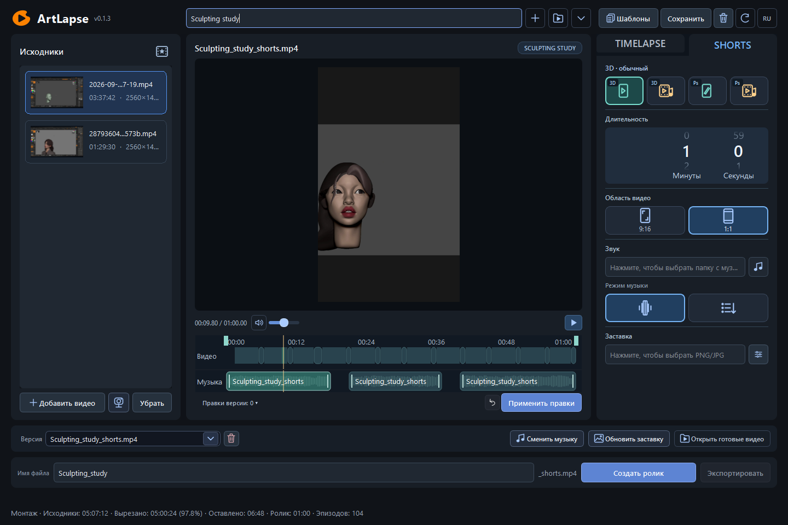
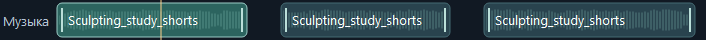
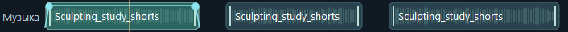

# ArtLapse

[English](README.md) | **Русский**

**[Скачать ArtLapse 0.1.3 для Windows x64](https://github.com/dmitriyermolenko81/ArtLapse/releases/download/v0.1.3/ArtLapse-0.1.3-Windows-x64.zip)** · [Что изменилось](https://github.com/dmitriyermolenko81/ArtLapse/releases/tag/v0.1.3)

Распакуйте ZIP целиком и запустите **ArtLapse.exe**. Python, Qt и FFmpeg уже включены.


Превращайте записи творческого процесса в таймлапсы и Shorts и доводите результат
ручным монтажом видео и музыки. Всё обрабатывается локально. Интерфейс доступен
на русском и английском; основная платформа — Windows x64.



Снимок работающего приложения с записью скульптинга ZBrush. Под большим
предпросмотром расположены две компактные дорожки; монтаж остаётся в основном окне.

## Новое в 0.1.3

- Общий каталог исходных эпизодов для всех режимов; каждый режим выбирает из него свои отрывки.
- Общие ручные исправления исходников и повторное использование готового анализа с указанием кэша.
- Компактные дорожки видео и музыки прямо в основном окне, с независимыми правками.
- Настоящие звуковые волны внутри фрагментов музыки, с фоновой загрузкой и кэшем.
- Разделение, подрезка и удаление музыки без перезаписи следующих фрагментов.
- Плавное начало и затухание добавляются по желанию через ПКМ на фрагменте.
- Горячие клавиши по наведению: Q / Й — разделить, Delete — удалить, Ctrl+Z / Ctrl+Y — отменить / вернуть.
- Пробел — воспроизведение / пауза; защита при вводе текста, перетаскивании и открытых диалогах.
- В версиях «под бит» изменение музыки заблокировано, чтобы сохранить синхронизацию.
- Просмотр начинается с самого начала, включая заставку или презентацию.
- Уточнена синхронизация звука; обновлены полосы прокрутки, включая список версий.

Устаревшие режимы стоп-кадров под музыку убраны из выбора режимов.
Совместимость существующих проектов сохранена.

| Волны внутри музыки | Плавное изменение громкости |
| --- | --- |
|  |  |

## Монтаж прямо на дорожках

Наведите мышь на **видео** или **музыку** и нажмите **Q / Й**, чтобы разделить
фрагмент в позиции мыши. Предварительный клик для выбора дорожки не нужен.
**Delete** удаляет фрагмент, **Ctrl+Z / Ctrl+Y** отменяют и возвращают правки
на этой дорожке. **Пробел** управляет воспроизведением. Тяните края для подрезки.
Применение правок создаёт новую версию и сохраняет предыдущий результат.

Через ПКМ на музыкальном фрагменте можно добавить или убрать плавное начало
и затухание. По умолчанию их нет. Новый трек вставляется в свободный промежуток
и заканчивается перед следующим фрагментом, сохраняя существующую музыку.
В версиях «под бит» музыкальная дорожка доступна только для просмотра.

## От записи до готового ролика

1. Создайте или откройте проект и добавьте MP4, MKV или MOV.
2. Выберите режим, длительность, кадрирование, музыку и заставку / презентацию.
3. Создайте ролик: готовый совместимый анализ используется повторно.
4. Просмотрите результат и отредактируйте эпизоды, видео и музыку. Исходники сохраняются.

| Раздел | Режимы |
| --- | --- |
| TIMELAPSE | Отбор эпизодов или непрерывное ускорение |
| SHORTS | Видеоэпизоды 3D или Photoshop, с синхронизацией под бит или без неё |

Shorts поддерживают вертикальную и квадратную компоновку. Заставка и презентация
входят в общую длительность. Экспорт использует оригиналы, просмотр может использовать proxy.
Проекты, версии и шаблоны настроек позволяют вернуться к работе позже.

## Обновления и поддержка

ArtLapse проверяет обновления GitHub в фоне; круговая стрелка запускает проверку
вручную. Распакуйте новый ZIP в отдельную папку. Для переноса настроек закройте
программу и скопируйте **data** из прежней папки приложения в новую.
Проекты и исходники оставьте на месте. [Подробнее об обновлении](docs/updates.md).

Программа бесплатна. [Поддержка на Boosty](https://boosty.to/manson93) добровольна
и не нужна для скачивания или использования.

## Запуск из исходников

Нужны Python **3.10+**, FFmpeg и ffprobe в `PATH`. Проверенная среда:
Windows 10 x64, Python 3.10, PySide6 6.8.3. FFmpeg должен поддерживать `libx264`.
Установка Python-зависимостей требует доступа к пакетному индексу.

Из корня репозитория в PowerShell:

```powershell
git clone https://github.com/dmitriyermolenko81/ArtLapse.git ArtLapse
cd ArtLapse
python -m venv .venv
.\.venv\Scripts\python.exe -m pip install -e ".[dev]"
.\.venv\Scripts\python.exe -m artlapse doctor
.\.venv\Scripts\python.exe -m artlapse.ui
```

Если FFmpeg отсутствует в `PATH`, задайте полные пути:

```powershell
$env:ARTLAPSE_FFMPEG = "C:\Tools\ffmpeg\bin\ffmpeg.exe"
$env:ARTLAPSE_FFPROBE = "C:\Tools\ffmpeg\bin\ffprobe.exe"
```

В окне создайте проект кнопкой **+**, добавьте видео, выберите режим,
длительность и музыку, затем нажмите **«Создать ролик»**. Кнопка **RU / EN**
справа вверху переключает язык. Колесо меняет длительность без текстового
курсора; ручной ввод включается щелчком ЛКМ по числу.

«Шаблоны» в верхней панели сохраняют именованные наборы настроек. **+** открывает
ввод имени в той же строке, **✓** сохраняет или применяет набор, корзина удаляет.
Во время создания **+** становится **×**: крестик или Escape возвращает прежний
выбор. Применение шаблона сохраняет текущие исходники и ручные правки,
а Ctrl+Z отменяет применение.

## Командная строка

```powershell
.\.venv\Scripts\python.exe -m artlapse --help
.\.venv\Scripts\python.exe -m artlapse run "D:\ArtLapseProjects\demo" "D:\Videos\recording.mp4" --target-seconds 600 --output "D:\Exports\timelapse.mp4"
```

Исходные записи, музыка и пользовательские проекты в репозиторий не входят.
Для локальной проверки можно сгенерировать синтетические записи:

```powershell
.\.venv\Scripts\python.exe -m artlapse fixtures artifacts/fixtures
```

## Переносная версия Windows

Если используете готовый переносной ZIP, распакуйте **всю папку** и запустите
`ArtLapse.exe`. В такой сборке Python, FFmpeg и ffprobe находятся внутри;
настройки и журналы сохраняются в `data` рядом с EXE.
Краткая инструкция на русском и английском: [Start.txt](packaging/Start.txt).
Переносите всю папку программы, включая служебные файлы.
Исходный репозиторий не содержит готовых EXE или видео.
Инструкции сборки: [docs/windows_build.md](docs/windows_build.md).

## Проверки

```powershell
.\.venv\Scripts\python.exe -m pytest -q
.\.venv\Scripts\python.exe -m ruff check .
.\.venv\Scripts\python.exe -m mypy src
```

Интеграционным проверкам нужны FFmpeg/ffprobe и доступный рабочий стол.
Необязательным тестам локального сервиса обратной связи нужен Node.js
с модулем `node:sqlite`; при его отсутствии они пропускаются.

Полная локальная проверка с журналами, реальным коротким экспортом,
ffprobe, декодированием и запуском окна:

```powershell
.\.venv\Scripts\python.exe scripts/validate.py
```

Результаты сохраняются в новой папке `artifacts/validation-*`, вне Git.
Только итоговый `PASS` в `report.json` подтверждает полный прогон.

GitHub Actions выполняет Ruff, mypy и быстрые тесты без FFmpeg. Полный прогон
с медиа и GUI выполняется указанной выше локальной командой; эти проверки
не подменяют друг друга. Настройка CI: [.github/workflows/quality.yml](.github/workflows/quality.yml).

## Устройство проекта

| Каталог | Содержимое |
| --- | --- |
| `src/sculptcut` | Модели, анализ, планировщик, рендер и PySide6-интерфейс |
| `tests` | Модульные, интеграционные и GUI-проверки |
| `packaging` | Сборка Windows, переносной ZIP и лицензии компонентов |
| `scripts` | Воспроизводимая проверка приложения |
| `services/feedback` | Необязательный сервис обратной связи, без личных конфигов |
| `docs` | Инструкции и формат разметки |

Настройка необязательного сервиса: [docs/feedback_setup.md](docs/feedback_setup.md).
Он не нужен для монтажа и экспорта.

Изменения: [CHANGELOG.md](CHANGELOG.md). Порядок работы с проектом:
[CONTRIBUTING.md](CONTRIBUTING.md).
Результаты локальной проверки: [подготовка GitHub](docs/GITHUB_PREPARATION.md).

## Ограничения

Анализ опирается на пиксели: он не знает геометрию модели и историю Undo.
Похожий кадр не доказывает отмену работы; результат нужно просматривать.
Качество распознавания не заявляется подтверждённым на размеченном наборе
реальных записей. Длинные видео требуют места для proxy и кэша.
Поведение на macOS и Linux отдельно не подтверждено.

## Лицензии

Условия бесплатного личного и коммерческого использования: [LICENSE](LICENSE).
Приложение не объявляется open source; сторонние лицензии сохраняются.
Замена LGPL-библиотек: [инструкция](docs/LIBRARY_REPLACEMENT.md).
Проверки Windows-выпуска: [статус](docs/launch/RELEASE_CHECKLIST.md).
Лицензии зависимостей и уведомления о компонентах находятся в
[packaging/THIRD_PARTY_NOTICES.md](packaging/THIRD_PARTY_NOTICES.md)
и [packaging/licenses](packaging/licenses).

Приложение ранее называлось SculptCut. Старые проекты и настройки совместимы.
Python API `sculptcut` и прежние команды сохранены; новое имя команд —
`artlapse` / `artlapse-gui`, также `python -m artlapse` / `python -m artlapse.ui`.
